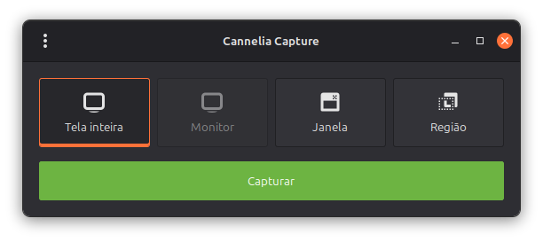
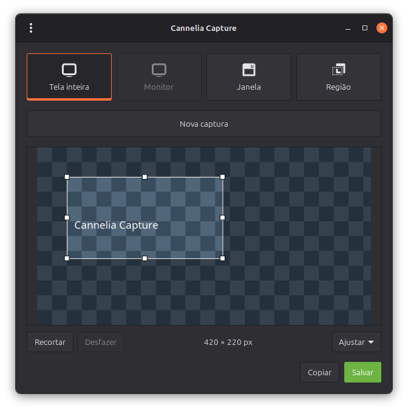
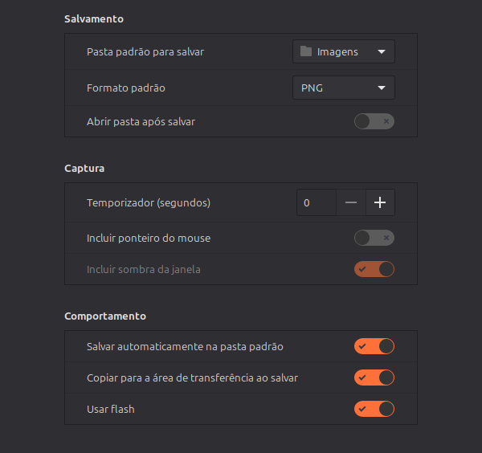
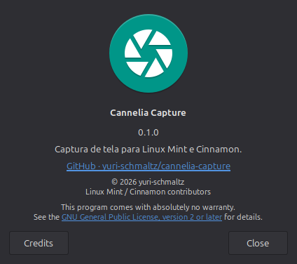

# Cannelia Capture 1.0.0

Captura de tela para **Linux Mint e Cinnamon**, com salvamento automático,
área de transferência, recorte ajustável e interface em português brasileiro.

Derivado do aplicativo `cinnamon-screenshot`, mantido como um projeto
independente por [yuri-schmaltz](https://github.com/yuri-schmaltz).
Licença: **GPL-2.0-or-later**. A origem do código e os créditos estão em
[NOTICE.md](NOTICE.md) e [AUTHORS.md](AUTHORS.md).



## Recursos

- Captura da tela inteira, monitor atual, janela ativa ou região selecionada.
- Salvamento automático na pasta **Imagens** do usuário, ativado por padrão.
- Cópia para a área de transferência ao salvar, ativada por padrão.
- Flash de confirmação, respeitando a preferência do aplicativo.
- Temporizador de 0 a 3.600 segundos nas Preferências.
- Prévia com oito alças de recorte, seleção móvel, dimensões em pixels e desfazer.
- Zoom: Ajustar, 50%, 100%, 150%, 200% e 400%, com rolagem.
- PNG, JPEG, BMP e TIFF.
- Notificações com **Abrir pasta**, sem acumular popups de cada captura.
- Proteção contra capturas simultâneas, nomes únicos e mensagens de falha.
- Instalação para o usuário, entrada no menu do Mint e atalhos configuráveis.
- Janela **Sobre o Cannelia Capture**, com versão, créditos e licença.



## Compatibilidade

O ambiente validado é **Linux Mint 22.3, Cinnamon 6.6.9 e sessão X11**.
O aplicativo também implementa o contrato de captura do Cinnamon mais recente,
mas essa combinação e o Wayland ainda precisam de validação funcional própria.

| Ambiente/backend | Recursos e limites |
| --- | --- |
| Cinnamon recente / `org.cinnamon.Screenshot` | Capturas, seleção de janela por clique, sombras e cópia pelo compositor |
| Cinnamon 6.6 / interface antiga | Tela, monitor, janela ativa e seleção de região; cópia feita pelo GTK |
| Alternativa X11 sem o serviço do Cinnamon | Tela e retângulos; sem seletor interativo, cursor ou sombras |

Na interface antiga, a janela é a que estiver ativa após a GUI desaparecer.
Escolher uma janela por clique, controlar a sombra separadamente e incluir
o cursor em uma região dependem do serviço novo. A opção de sombra fica
desabilitada quando indisponível. O app não implementa um portal genérico
de captura para outros desktops Wayland.

## Instalação pelo pacote Debian (recomendado)

Baixe `cannelia-capture_1.0.0_all.deb` na
[release v1.0.0](https://github.com/yuri-schmaltz/cannelia-capture/releases/tag/v1.0.0).
No diretório do download, execute:

```bash
sudo apt install ./cannelia-capture_1.0.0_all.deb
cannelia-capture --interactive
cannelia-capture --version
```

O APT instala as dependências. O pacote é `all` (Python, sem código nativo
embutido); o ambiente funcional validado continua sendo Mint 22.3/Cinnamon/X11.
Abra também **Cannelia Capture** pelo menu. O pacote instala em `/usr/share/cannelia-capture`,
sem substituir componentes do Cinnamon, e inclui traduções, schema, créditos e licença.
Verifique o download com o `SHA256SUMS` disponibilizado na release:

```bash
sha256sum -c SHA256SUMS
```

O pacote não altera atalhos pessoais durante a instalação. Em **Configurações do
Sistema → Teclado → Atalhos personalizados**, associe Super + Shift + A/S/D a
`cannelia-capture`, `cannelia-capture --area` e `cannelia-capture --window`, respectivamente.

Se já usa o instalador por usuário abaixo, as preferências em
`~/.config/cinnamon-screenshot-local` são compartilhadas. Para evitar duas entradas
no menu, remova a instalação antiga com `./install-screenshot.py --uninstall`
antes de configurar os novos atalhos; essa remoção preserva suas preferências e
restaura os atalhos anteriores ainda gerenciados pelo instalador.
Os exemplos com `~/.local/bin/cinnamon-screenshot-local` deste documento
podem ser usados com o pacote substituindo o comando por `cannelia-capture`.

Para atualizar, instale o `.deb` novo com `sudo apt install ./arquivo.deb`.
Para remover, use `sudo apt remove cannelia-capture`. Preferências e capturas
pessoais são preservadas, inclusive com `apt purge`.

### Construir o pacote a partir do código-fonte

```bash
sudo apt install git python3 gettext libglib2.0-bin desktop-file-utils dpkg-dev
/usr/bin/python3 tools/build-deb.py
```

O arquivo aparece em `dist/`. O build não usa sudo, não instala o aplicativo e
não acessa credenciais. `SOURCE_DATE_EPOCH` controla os horários; por padrão,
é usado o commit atual. Com a mesma árvore, ferramentas e valor dessa variável,
o pacote é reproduzível. Para verificar o pacote e o lançamento extraído (com as dependências de execução
instaladas e uma sessão gráfica ativa):

```bash
sudo apt install lintian
lintian dist/cannelia-capture_1.0.0_all.deb
/usr/bin/python3 tests/test-deb.py
```

## Instalação por usuário a partir do código-fonte

Use o Python do sistema para ter acesso ao GTK e às bibliotecas do Mint.
Não é necessário compilar ou reinstalar o desktop Cinnamon.

```bash
sudo apt update
sudo apt install git python3 python3-gi python3-gi-cairo python3-cairo \
  gir1.2-gtk-3.0 gir1.2-xapp-1.0 python3-xapp gettext libglib2.0-bin \
  desktop-file-utils

git clone https://github.com/yuri-schmaltz/cannelia-capture.git
cd cannelia-capture
./install-screenshot.py
```

Abra **Cannelia Capture** no menu do Mint ou execute:

```bash
~/.local/bin/cinnamon-screenshot-local --interactive
```

O nome do lançador, do schema e das pastas internas permanece compatível
com as primeiras instalações. O nome apresentado ao usuário é Cannelia Capture.

O instalador copia o app para `~/.local/share/cinnamon-screenshot-local`, cria
o lançador em `~/.local/bin` e registra a entrada do menu. A instalação continua
funcionando se o clone for movido ou removido. Não execute o instalador com sudo.

Para instalar sem configurar os atalhos:

```bash
./install-screenshot.py --no-shortcuts
```

## Uso e atalhos

| Ação | Atalho padrão |
| --- | --- |
| Tela inteira | **Super + Shift + A** |
| Selecionar região | **Super + Shift + S** |
| Janela atual | **Super + Shift + D** |

Super normalmente é a tecla com o símbolo do Windows. O Cinnamon trata os
Shifts esquerdo e direito como o mesmo modificador. Os atalhos são globais;
a interface não precisa estar aberta.

O instalador verifica conflitos com os atalhos do Cinnamon e preserva os
valores anteriores. Se houver conflito, o app pode ser instalado com
`--no-shortcuts`; ajuste as combinações em **Configurações do Sistema →
Teclado → Atalhos → Atalhos personalizados**.

Na GUI, escolha o tipo de captura e clique em **Capturar**. Com os padrões
iniciais, o arquivo será salvo em Imagens e copiado para a área de
transferência. A prévia continua disponível para edição. Nas capturas por
atalho, o editor não abre quando o salvamento automático está ativo.

Para recortar, arraste sobre a imagem, ajuste as oito alças ou mova a seleção
por seu interior e clique em **Recortar**. O tamanho aparece em pixels.
O zoom não altera as coordenadas do recorte. **Desfazer** ou **Ctrl + Z**
restaura a imagem anterior. Edite e salve novamente para gravar o recorte;
a cópia automática anterior não é modificada pela edição.

**Esc** fecha o editor ou cancela o seletor de região/janela. Se uma captura
já estiver em andamento, um novo acionamento é recusado com uma mensagem.

## Preferências e idioma

Abra **Menu ⋮ → Preferências** para configurar:

- **Salvamento:** pasta, formato e abertura da pasta após salvar.
- **Captura:** temporizador, ponteiro do mouse e sombra da janela.
- **Comportamento:** salvamento automático, cópia ao salvar e flash.

As preferências são lidas a cada captura, inclusive pelos atalhos. Uma pasta
inválida gera erro; o app não troca silenciosamente o destino pela pasta pessoal.

A interface oferece **pt-BR** e inglês. O idioma segue `LANGUAGE`/`LANG` do
ambiente. Para testar português brasileiro sem alterar o sistema:

```bash
LANGUAGE=pt_BR ~/.local/bin/cinnamon-screenshot-local --interactive
```

O catálogo local complementa o catálogo de traduções do Cinnamon instalado.

<details>
<summary>Preferências e Sobre</summary>





</details>

## Linha de comando

Os exemplos abaixo usam o lançador instalado. Para executar pelo clone,
substitua-o por `./run-screenshot.py`.

```bash
# Interface
~/.local/bin/cinnamon-screenshot-local --interactive

# Capturas com as preferências atuais
~/.local/bin/cinnamon-screenshot-local
~/.local/bin/cinnamon-screenshot-local --area
~/.local/bin/cinnamon-screenshot-local --window
~/.local/bin/cinnamon-screenshot-local --monitor 0

# Destino explícito e atraso de três segundos
~/.local/bin/cinnamon-screenshot-local --delay 3 --file "$HOME/Imagens/captura.png"

# Copiar sem salvar em arquivo; --clipboard com --file faz ambos
~/.local/bin/cinnamon-screenshot-local --clipboard

# Diagnóstico sem capturar e lista de opções
~/.local/bin/cinnamon-screenshot-local --check
~/.local/bin/cinnamon-screenshot-local --help

# Medir tempo até salvar; não exibir notificações
~/.local/bin/cinnamon-screenshot-local --file /tmp/captura.png --profile --no-notification
```

`--window`, `--select-window`, `--area` e `--monitor` são mutuamente exclusivos.
`--select-window` requer o serviço novo. `--include-shadow` requer um modo
de janela. O índice do monitor começa em zero; um índice indisponível recai
na tela inteira. `--delay` aceita 0–3.600 e substitui o temporizador salvo.
O modo `--interactive` não aceita os argumentos de atraso, cursor ou sombra:
use as Preferências. Sem extensão reconhecida, o arquivo é codificado como PNG.

Falhas retornam código 1; argumentos inválidos retornam 2. Cancelar uma
captura com destino explícito `--file` retorna 1. O perfil é emitido como JSON
no stderr e mede desde a entrada no lançador até o arquivo salvo.

## Atualizar e remover

```bash
cd cannelia-capture
git pull --ff-only
./install-screenshot.py
```

As preferências existentes são preservadas. Após editar ou atualizar o clone,
reexecute o instalador para atualizar a cópia usada pelo menu e pelos atalhos.

```bash
/usr/bin/python3 ~/.local/share/cinnamon-screenshot-local/install-screenshot.py --uninstall
```

A remoção restaura os atalhos anteriores que não foram editados depois da
instalação e preserva as preferências. As pastas usadas são:

| Conteúdo | Local padrão |
| --- | --- |
| Preferências instaladas | `~/.config/cinnamon-screenshot-local` |
| Cache instalado | `~/.cache/cinnamon-screenshot-local` |
| Entrada do menu | `~/.local/share/applications/cinnamon-screenshot-local.desktop` |
| Estado no modo de desenvolvimento | `.local-screenshot/`, ignorado pelo Git |
| Bloqueios e notificação ativa | subpasta `cinnamon-screenshot-UID` de `$XDG_RUNTIME_DIR` |

O app não possui telemetria própria nem serviço remoto. As imagens ficam
no destino escolhido; copiar expõe a imagem à área de transferência da sessão.

## Desempenho e validação

O schema e as traduções são recompilados apenas quando necessário. Novos
PNGs podem ser gravados diretamente pelo compositor, evitando a regravação.
No Cinnamon 6.6, copiar ainda exige decodificar a imagem para o GTK.

Em cinco amostras locais de 1920×1080, a mediana da etapa de captura e
salvamento caiu de **434 ms para 225 ms** (48%). Isso não representa o tempo
total de todos os modos: inicialização, atraso, cópia e notificações não
estão incluídos nessa comparação. Os resultados variam por máquina e imagem.

```bash
/usr/bin/python3 tests/test-screenshot-local.py
/usr/bin/python3 tools/benchmark-screenshot.py --full-screen --samples 5 \
  --output .local-screenshot/performance.json
```

Os testes usam imagens sintéticas. O benchmark usa capturas reais em uma
pasta temporária e apaga os arquivos ao terminar; sem `--full-screen`, captura
apenas um pixel. Veja [CONTRIBUTING.md](CONTRIBUTING.md) para o ambiente de testes.

## Documentação, origem e licença

- [Tudo que foi alterado](docs/CHANGES.md).
- [Histórico de versões](CHANGELOG.md).
- [Arquitetura e desenvolvimento](CONTRIBUTING.md).
- [Solução de problemas](docs/TROUBLESHOOTING.md).
- [Créditos e proveniência](NOTICE.md) e [autores](AUTHORS.md).
- [Licença GPL v2](LICENSE), com a opção **ou qualquer versão posterior**.

Cannelia Capture é uma versão modificada e independente do aplicativo do
Cinnamon, não um lançamento oficial do Linux Mint. Os direitos dos autores
originais são preservados. O programa é fornecido **sem garantia**; pode ser
redistribuído e modificado nos termos da GPL-2.0-or-later.
